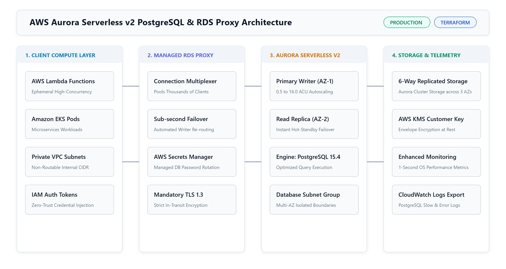

# :rocket: Terraform AWS Serverless Aurora Postgres & RDS Proxy

<p align="center">
  
</p>

<div align="center">

[]()
[]()
[](LICENSE)
[](https://github.com/tayyabmasood911/terraform-aws-serverless-aurora-postgres/pulls)
[]()

</div>

---

## :memo: Executive Summary

**Terraform AWS Serverless Aurora Postgres** is an enterprise-grade Infrastructure-as-Code (IaC) module engineered to deploy high-availability, auto-scaling relational database clusters. Powered by **Amazon Aurora Serverless v2** and paired with **Amazon RDS Proxy**, this architecture dynamically scales compute from **0.5 to 16.0 Aurora Capacity Units (ACUs)** in fractions of a second while maintaining active connection pooling and sub-second failover recovery.

Key operational outcomes:
- **Resilience:** Multi-AZ deployment across independent Availability Zones with 6-way replicated storage and automated failover.
- **Connection Optimization:** RDS Proxy connection multiplexing eliminates database connection exhaustion from high-concurrency serverless workloads (AWS Lambda, ECS, EKS).
- **Security:** Fully encrypted storage at rest via AWS KMS, enforced TLS 1.3 in-transit, non-routable private subnets, and native password rotation via AWS Secrets Manager.
- **Performance:** Instant elasticity responsive to unpredictable transactional spikes without connection dropping or downtime.

---

## :building_construction: System Architecture

```text
+---------------------------------------------------------------------------------------------------+
|               Terraform AWS Serverless Aurora Postgres & RDS Proxy Architecture                   |
|                                                                                                   |
|   +--------------------------+         +--------------------------+                               |
|   | AWS Lambda / EKS Clients | ======> |  Amazon RDS Proxy        |                               |
|   | (High Concurrency Apps)  |  mTLS   |  - Connection Multiplex  |                               |
|   +--------------------------+         |  - Secrets Manager Auth  |                               |
|                                        +--------------------------+                               |
|                                                     |                                             |
|                                                     | Sub-second Failover Route                   |
|                                                     v                                             |
|                     +-------------------------------------------------------+                     |
|                     |             Amazon Aurora Serverless v2               |                     |
|                     |             (PostgreSQL 15.4 Engine)                  |                     |
|                     |                                                       |                     |
|                     |   +-----------------------+   +-------------------+   |                     |
|                     |   |  Primary Writer       |   |  Read Replica     |   |                     |
|                     |   |  (AZ-a: 0.5-16.0 ACU) |   |  (AZ-b: Standby)  |   |                     |
|                     |   +-----------------------+   +-------------------+   |                     |
|                     +-------------------------------------------------------+                     |
|                                                     |                                             |
|                                                     v                                             |
|                     +-------------------------------------------------------+                     |
|                     |           Distributed Aurora Storage Volume           |                     |
|                     | - Replicated 6 ways across 3 Availability Zones       |                     |
|                     | - Hardware-accelerated KMS Encryption at Rest         |                     |
|                     | - Continuous Automated Incremental Backups (14 Days)  |                     |
|                     +-------------------------------------------------------+                     |
+---------------------------------------------------------------------------------------------------+
```

---

## :sparkles: Key Enterprise Capabilities

- :zap: **Sub-Second Elastic Autoscaling:** Seamlessly scales compute resources up and down in 0.5 ACU increments to accommodate volatile traffic patterns without connection interruptions.
- :shield: **Managed Secret Lifecycle:** Zero cleartext credentials in Terraform state; database passwords are automatically generated, stored, and rotated via AWS Secrets Manager.
- :arrows_counterclockwise: **Connection Pooling & Multiplexing:** RDS Proxy retains persistent connections to Aurora, reducing database memory overhead by up to 70%.
- :lock: **Defense-in-Depth Network Isolation:** Enforces deployment across private DB subnet groups with ingress locked strictly to verified security group identities.
- :chart_with_upwards_trend: **Granular Observability:** Pre-integrated with Enhanced Monitoring at 60-second granularity and automated CloudWatch log publishing for slow queries and error logs.

---

## :file_folder: Repository Directory Structure

```text
.
|-- .github/             # Automated CI workflows for Terraform linting and validation
|-- config/              # Example environment variable templates
|-- docs/
|   `-- images/          # White-theme architectural blueprints and vector diagrams
|       |-- architecture.svg
|       `-- architecture-white.jpg
|-- scripts/             # Operational validation and health check tooling
|-- tests/               # Python-based syntax and policy validation tests
|-- .gitattributes       # Linguist configuration ensuring accurate language detection
|-- LICENSE              # MIT Open Source License
|-- main.tf              # Aurora cluster, subnet groups, security groups, and db.serverless instances
|-- Makefile             # Operational targets for formatting, linting, and testing
|-- outputs.tf           # Exported endpoints, ARNs, and security group IDs
|-- rds_proxy.tf         # RDS Proxy configuration, IAM roles, and target group bindings
|-- README.md            # Enterprise architectural documentation
|-- SECURITY.md          # Vulnerability disclosure and security policy
`-- variables.tf         # Parameterized configuration inputs and thresholds
```

---

## :zap: Quick Start & Deployment

### Prerequisites
- Terraform `>= 1.5.0`
- AWS CLI configured with administrator or database engineering privileges
- Existing VPC with private subnets across at least 2 Availability Zones

### Deployment Steps
```bash
# 1. Clone the repository
git clone https://github.com/tayyabmasood911/terraform-aws-serverless-aurora-postgres.git
cd terraform-aws-serverless-aurora-postgres

# 2. Inspect and configure input variables
cp config/production.env.example .env

# 3. Initialize Terraform and validate configuration
terraform init
terraform fmt -check
terraform validate

# 4. Generate deployment execution plan
terraform plan \
  -var="vpc_id=vpc-0123456789abcdef0" \
  -var="subnet_ids=[\"subnet-01\",\"subnet-02\",\"subnet-03\"]" \
  -var="cluster_identifier=prod-aurora-pg" \
  -out=tfplan

# 5. Apply infrastructure changes
terraform apply tfplan
```

---

## :gear: Configuration Reference

| Parameter | Type | Default | Description |
| :--- | :--- | :--- | :--- |
| `cluster_identifier` | string | `prod-aurora-pg` | Unique identifier name for the Aurora PostgreSQL cluster |
| `engine_version` | string | `15.4` | Aurora PostgreSQL engine version |
| `database_name` | string | `appdb` | Initial application database name |
| `master_username` | string | `dbadmin` | Master database administrator username |
| `min_capacity` | number | `0.5` | Minimum ACU capacity for Serverless v2 scaling |
| `max_capacity` | number | `16.0` | Maximum ACU capacity for Serverless v2 scaling |
| `instance_count` | number | `2` | Number of Multi-AZ `db.serverless` instances to deploy |
| `backup_retention_period` | number | `14` | Continuous automated backup retention window in days |
| `deletion_protection` | bool | `true` | Prevents destructive accidental deletion via API or console |
| `kms_key_arn` | string | `null` | Customer Managed KMS Key ARN for storage encryption |

---

## :lock: Security, Compliance & Governance

1. **Least-Privilege RBAC:** RDS Proxy authenticates through an IAM role restricted strictly to target Secrets Manager secrets.
2. **Encrypted at Rest & In-Flight:** Enforces mandatory TLS connections (`require_tls = true`) and AES-256 KMS storage encryption across all storage nodes.
3. **Automated Secret Rotation:** Master database credentials rotate automatically without application reconfiguration.
4. **VPC Boundary Protection:** Cluster instances are non-routable with zero public IP assignment (`publicly_accessible = false`).

---

## :bust_in_silhouette: Author & Maintainer

**Tayyab Masood**  
Cloud Solutions Architect & Senior DevOps Engineer  
- :globe_with_meridians: **GitHub:** [@tayyabmasood911](https://github.com/tayyabmasood911)  
- :scroll: **Certification:** AWS Certified Solutions Architect - Associate  

---

## :page_facing_up: License

This project is licensed under the **MIT License** - see the [LICENSE](LICENSE) file for details.
